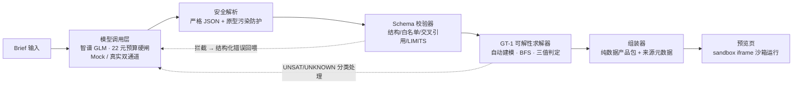

# AI Game Design Agent Workbench · AI 游戏设计智能体工作台

> **一句话**：输入一句 Brief，经过五道自动化闸门，产出一个能在浏览器沙箱里直接玩网格解谜游戏——生成产物是纯 JSON 数据，全程不产生一行可执行代码。
>
> 这是转岗 AI 游戏产品岗的作品集项目。它的重点不是"想法完整"，而是**结论有多少证据、代码跑到哪一步**——所有"已验证"都有测试或签收单背书，所有"未验证"如实标注。

---

## 当前状态（2026-11-17，分层口径，拒绝"整体已完成"式的含糊）

| 模块 | 状态 | 内容 | 证据 |
|---|---|---|---|
| **M0 安全隔离** | ✅ 已签收闭合 | sandbox iframe + CSP + postMessage 双向来源/类型校验 + 受限流式 JSON 拉取（大小限制先于解析） | 决定记录 v1.1；Node 31 + 浏览器实测 13 |
| **M1 生成核心** | 🔶 骨架完成，**真实 API 未联调** | Prompt 模板 v1 / 智谱适配层 / 生成档案（原始输出·Prompt 版本·Token·时延全留痕） | 18 项单测（mock 注入，零网络） |
| **M2 校验与预算** | ✅ 已签收闭合 | Schema 校验器（v1.2.1 全量）· GT-1 可解性求解器 · 拦截-重试闭环 · **22 元预算硬闸门** · GLM 双模型 Tokenizer 接入 | 68 项测试；签收单 2026-11-16 |
| **M3 运行时与工作台** | 🔶 进行中（三步已落地） | Runtime 接入桥 · GT-2a 逐步观测断言 · 最小预览页 · **最小工作台 MVP** | 8 + 4 项测试；浏览器通关实测 |
| **端到端闭环** | ✅ 打通（Mock 通道） | 候选 → 五道闸门 → 产品包 → 预览页 → 键盘 13 步通关 | 浏览器实测截图与事件流档案 |

**测试规模：150 项自动化测试全绿**（M0 31 / M1 18 / M2 68 / M3 8 / 端到端 4 / 工作台 8 / 浏览器冒烟 13）。

**如实边界**：真实模型能否稳定产出过闸门的 JSON **未验证**（M1 联调待密钥）；Mock 通道候选为注入产物（页面常驻 MOCK 徽章，与真实结论物理分离——档案、台账、产品目录三重隔离）；3 个独立验证样本按纪律隔离，未参与任何调优。

---

## 核心设计：为什么说"生成产物只是数据"

产品要生成游戏，而生成内容不可信——所以架构上让**生成物永远走数据通道，不走代码通道**：



几个值得展开的点：

- **生成数据永不作为脚本加载**：模型输出以 `application/json` 提供，宿主受限流式拉取（`Content-Length` 头筛 → 逐块计数 → `JSON.parse`，超限在解析前中止）→ 受控 postMessage（结构化克隆）递入 `sandbox="allow-scripts"` 游戏帧 → 帧内契约守卫二次校验。数据全程只经过 JSON.parse、结构化克隆、文本渲染三个通道，没有任何一处把字符串当代码求值。
- **GT-1 自动建模求解器**：不手写游戏模型——**DSL 运行时本身就是状态转移函数**，vm 沙箱加载真实引擎，对状态枚举四向转移做 BFS。三值结果严格落地：PASS / UNSAT（完整穷举）/ UNKNOWN（超限或存在运行时异常，**禁止改写为 UNSAT**）。与旧 Python 手写模型双路线回归，八关最少步数逐一相符。
- **22 元预算硬闸门**：预留 → 核销 → 释放三段式，reservation ID 状态机贯穿；请求前按模型单价×Token 上限预估、超支拒绝；未解决 hold 阻塞后续调用；跨进程文件锁 + 台账派生式自愈；并发实测 2115 笔核销 21.996 元不破限。
- **拦截-重试闭环**：错误四分类（schema / json_parse / auth / network），Schema 错误清单结构化回喂模型重试；鉴权失败与无密钥绝不重试；每次尝试、失败、重试全留档。
- **GLM Tokenizer 接入**：Node 主程序 + Python sidecar（transformers 锁定版本，模型仓库锁 revision），对完整 messages 应用 chat template 后精确计数；Tokenizer 不可用时显式降级为分字符保守估算并如实标注来源——**估算不伪装成精确**。

---

## 快速上手

依赖：Node.js ≥ 22（测试与工作台均为零网络依赖，无需任何 API 密钥即可复现）。

```bash
cd 12_G1_生成管线

# 七套自动化测试
node security/security-tests.js        # M0 安全层        31 ✓
node pipeline/m1-tests.js              # M1 生成核心      18 ✓
node validator/m2-tests.js             # M2 校验/求解     32 ✓
node pipeline/m2-loop-tests.js         # M2 闭环          36 ✓
node m3/m3-tests.js                    # M3 Runtime/GT-2a  8 ✓
node pipeline/e2e-tests.js             # 端到端闭环        4 ✓
node m3/workbench/workbench-tests.js   # 工作台编排        8 ✓

# 启动工作台（默认 Mock 通道，页面有常驻 MOCK 徽章）
node m3/preview/preview-server.js
# → http://127.0.0.1:8792/workbench    工作台：选 Brief → 生成 → 看闸门 → 进预览游玩
# → http://127.0.0.1:8792/preview/gameA_推箱   直接玩四机制构造样本
```

浏览器冒烟（需本机 Edge）：`node m3/workbench/workbench-smoke.js`。

---

## 目录地图

| 目录 | 内容 |
|---|---|
| `00_立项文档` | v2.0 总体方案、S4 场景决策包、前置 2–5（Schema/GT/IA/预算）、17.8 预算核定、M0 决定记录 |
| `01`–`03` | 招聘调研（20 条 JD 矩阵）、业务访谈与二手证据卡、竞品研究 |
| `04`–`10` | 世界观资产、任务设计、规则原型、评测、界面、**gdw 配置检查工具**（前一阶段作品，157 项测试，保留）、作品集一页纸 |
| `11_Spike_网格解谜` | 四机制构造样本（推箱/钥匙门/碎裂地板/开关闸门）+ 可信 DSL Runtime + 生成档案 |
| `12_G1_生成管线` | **当前主战场**：`security/`（M0）、`pipeline/`（M1+重试闭环+预算+工作台）、`validator/`（M2）、`m3/`（Runtime 桥+GT-2a+预览页+工作台）、`archives/`（生成档案与台账） |
| `99_归档` | 过期文档旧版本，不删只归档 |

---

## 里程碑时间线

| 日期 | 事件 |
|---|---|
| 11-06 ~ 11-09 | 立项：v1.2.2 → v2.0 总体方案（多品类愿景收窄为网格解谜 MVP 验证） |
| 11-11 | S4 场景决策包；Spike 四机制人工协作生成（**如实记录：Spike 阶段无自动档案**） |
| 11-12 | S4 签收；G1 批准开工；M0 沙箱安全边界（数据通道返工：脚本注入 → fetch JSON + 受控 postMessage） |
| 11-13 | M0 签收闭合（浏览器实测抓出 3 个 Node 测试盲区）；M1 骨架（Prompt/适配层/档案） |
| 11-16 | M2 全量落地并签收：校验器/GT-1/重试闭环/预算硬闸 v4（预留-核销-释放+跨进程锁）/GLM Tokenizer（113 项测试） |
| 11-17 | M3 三步落地 + 端到端闭环（Mock）+ 最小工作台 MVP（150 项测试）；GitHub 首次入库 |

---

## 三种读法

- **5 分钟**：本 README + 里程碑时间线——看架构和分层状态。
- **审证据**：`00_立项文档/`（签收单与决定记录）→ `12_G1_生成管线/archives/`（每次生成调用的原始输出、Token、预算台账）→ `12_G1_生成管线/m3/workbench/`（浏览器冒烟脚本与截图）。**口径纪律：统计数字与实跑一致，"模拟"不冒充"实装"，"设计级验收"不冒充"工具已实装"。**
- **看代码 / 上手玩**：`cd 12_G1_生成管线 && node m3/preview/preview-server.js`，选个 Brief 点生成，然后进预览用方向键通关。

---

## 工作区规矩（全程有效）

1. **结论只写三态**：已验证 / 已推翻 / 未验证。不写"基本验证"。
2. **模拟与真实物理分离**：Mock 档案、模拟台账、Mock 产品与真实通道互不污染，页面与返回值如实标注。
3. **生成物只是 JSON**：任何情况下不允许生成数据进入脚本求值路径——这一条有 31 项 M0 测试守着。
4. **人类是 GT-3 最终放行者**：机器只查可解性与结构，"这游戏好不好玩"由人签字。
5. **`.workbuddy/` 是本地工作记忆**，不入库（已 gitignore）。

---

## 下一步

1. **M1 真实 API 联调**（待密钥）：真实 Brief 生成 → Tokenizer 计数 vs `usage.prompt_tokens` 对照 → 7 个调优样本试跑（费用计入 22 元总预算）；
2. **M3 收口**：真实生成产物走完整链路进预览页（M0+M2 双闸门下运行）、生成过程实时流式展示；
3. **GT-2a 断言库扩展**：随真实产物的新机制逐步补充。

---

*License / 引用：个人作品集项目。如需参考架构或测试设计，欢迎提 issue 交流。*
